# ChatGPT Image Studio for Photoshop

**English** | [简体中文](README.zh-CN.md)

[Download / Releases](https://github.com/springcell/ChatgptImageStudio-Of-Photoshop/releases) · [Installation](#download-and-install-windows) · [Toolbar guide](#floating-toolbar-at-a-glance) · [Troubleshooting](#troubleshooting)

**Local Edition v0.3.5** · Windows · Adobe Photoshop 25.2+ · UXP

**Generate, edit, remove, and expand images inside Adobe Photoshop.**

ChatGPT Image Studio combines natural-language image generation with a compact Photoshop editing toolbar. Generate new artwork, guide edits with image-region comments, remove backgrounds or objects, and expand a composition to a new aspect ratio.

<p align="center">
  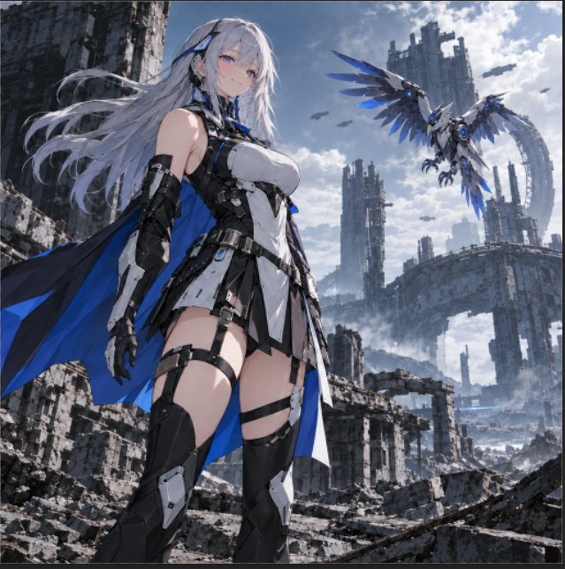
</p>

<p align="center"><strong>Prompt · Comment · BG · Erase · Size</strong></p>

> [!NOTE]
> This is an **independent, community-made Photoshop integration**, not an official Adobe or OpenAI product. Model options, API availability, output behavior, and installation screens may vary by release. Screenshots illustrate the workflow; they do not prove every model/provider combination was tested.

## Download and install (Windows)

**Requirements:** Windows, **Adobe Photoshop 25.2 or later**, [Adobe UXP Developer Tool (UDT)](https://developer.adobe.com/photoshop/uxp/2022/guides/devtool/), internet access for remote image generation, and an API credential for the provider you want to use.

1. Open **[GitHub Releases](https://github.com/springcell/ChatgptImageStudio-Of-Photoshop/releases)** and, once v0.3.5 is published, download **`chatgpt-image-studio-local-0.3.5.zip`**.
2. **Extract all files** to the `Plug-ins` folder. Keep the whole extracted folder together; the Photoshop plugin loads files from `plugin/`.
3. Double-click **`Install.cmd`** in the extracted folder. This installs and starts the **desktop floating toolbar**; it does **not** automatically install the Photoshop panel.
4. Open **Adobe UXP Developer Tool (UDT)**. Choose **Add Plugin**, browse to **`plugin/manifest.json`** in the extracted folder, and then **Load** the plugin from UDT.
5. In Photoshop, open the **chatgpt image studio Local** panel from the **Plugins** menu (location can vary by Photoshop version).
6. Keep the extracted bundle in place while using the plugin. After updating the extracted files, run **`Install.cmd`** again and reload the manifest in UDT.

The extracted release should contain:

```text
chatgpt-image-studio-local-0.3.5/
├── Install.cmd              # Installs desktop toolbar
├── Install.ps1
├── ImageStudioToolbar.exe
├── Diagnose.cmd             # Checks desktop toolbar installation
├── Uninstall.cmd
├── README.txt
├── assets/
└── plugin/
    ├── manifest.json        # Load this file in UDT
    ├── index.html
    ├── main.js
    └── ...
```

> [!IMPORTANT]
> Run `Install.cmd` **and** load `plugin/manifest.json` via UDT. These are two different setup steps and both are required.

## First-time setup

1. Open the Photoshop plugin panel and click the **settings icon** in the top-right corner.
2. Set **Language** (`English` or `Chinese`) and **Provider** (for example, OpenAI or a compatible gateway such as sub2api).
3. For the official OpenAI API, leave **API base URL** blank to use the default `https://api.openai.com/v1`, or enter it explicitly. For another provider, use the endpoint supplied by that provider.
4. Enter your **API Key**. The plugin uses **local UXP secureStorage** for API configuration; according to the package documentation, it does not send the API key to the desktop toolbar.
5. Choose an available **Image model**. Version 0.3.5 includes **Flare 2.5**, **Sunburst 2.5**, **Flare 2.6**, and **Sunburst 2.6** provider-facing options. Actual access depends on your provider.
6. Click **Save settings**, then **Test API**. The API test requests the **model list only**; it does **not** verify image-generation permission or performance.
7. Enable **Remember edits** if desired. Use **Show toolbar / Hide toolbar** to toggle the floating toolbar.

<p align="center">
  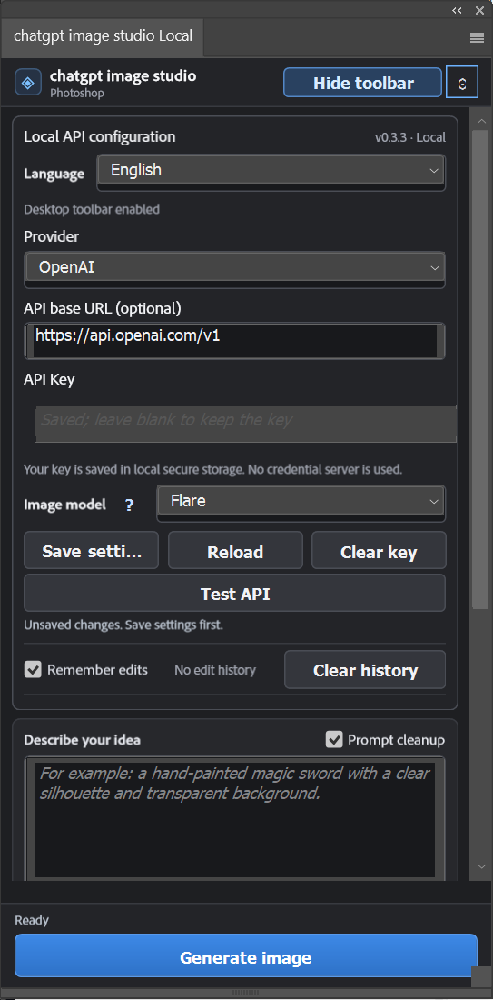
</p>

> [!NOTE]
> **Model compatibility in v0.3.5 (per bundled release notes):** Sunburst 2.6 passed a direct non-streaming generation check. Flare 2.6 is **unverified**; 2.6 streaming, editing, Photoshop-host integration, and sub2api compatibility **still require testing**. The names are provider-facing labels; they do not establish official public OpenAI model IDs.
>
> When changing your API provider or endpoint, re-enter your API key. Use HTTPS for public endpoints; HTTP on local/private LAN connections is unencrypted.

## Generate your first image

1. In **Describe your idea**, write a visual prompt. For example:

   > Generate a sci-fi anime-style female warrior standing before ruins.

2. Optionally enable **Prompt cleanup**, add **References** (up to 16 are shown in the example UI), or choose **Use PS selection** to supply your current Photoshop selection as a reference.
3. Set **Width** and **Height** (or choose an available preset). Choose **Quality** and **Background**: `Auto`, `Transparent`, or `Opaque`.
4. Click **Generate image**.
5. A **partial preview** may appear during generation. Allow the request to complete; the example workflow opens the **final result in a new Photoshop document**.

<p align="center">
  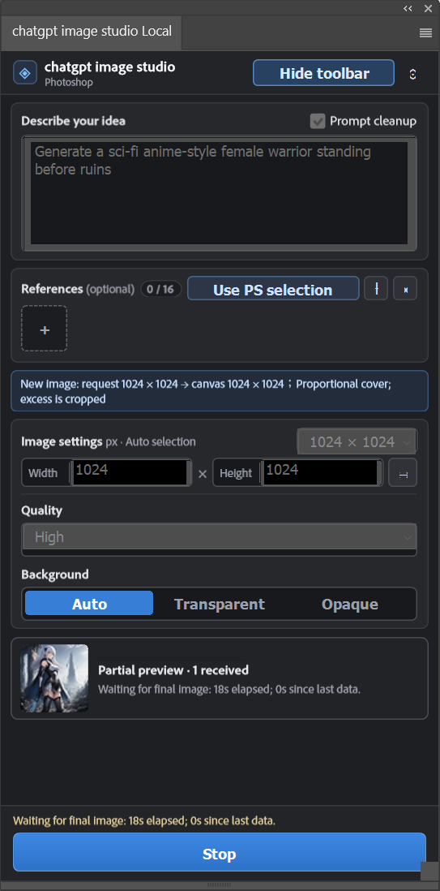
</p>

**Example result**

<p align="center">
  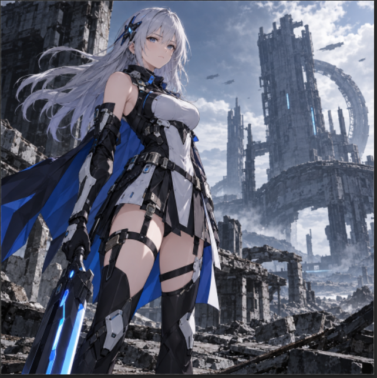
</p>

**Tip:** Use the aspect ratio you actually need. When the requested dimensions differ from the generated composition, the plugin may fit or crop the image to the canvas, as indicated in the request summary.

## Floating toolbar at a glance

After an image is open in Photoshop and the desktop toolbar is enabled, five editing actions are available:

<p align="center">
  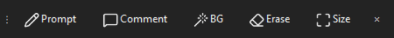
</p>

| Action | What it does |
|:--|:--|
| 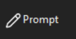 | Describe a new edit in plain language and send it to the image model. |
| 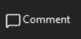 | Place separate instructions on specific regions of the image. |
| 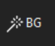 | Work with the background, including creating transparent-background output. |
| 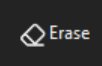 | Select an unwanted area and have it removed/reconstructed. |
| 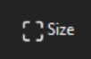 | Change the framing/aspect ratio and generate the additional composition. |

### 1. Prompt — describe a change

Select **Prompt** from the toolbar, type what you want to create or change, then click **Send**. Use clear instructions about the subject, environment, color, or desired edit.

<p align="center">
  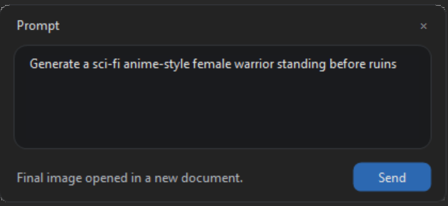
</p>

### 2. Comment — direct edits by region

Select **Comment** to open **Region comments**. Mark individual regions on the picture, give each region its own instruction, and click **Send** to apply the edit request.

In this example, three instructions are attached to the artwork:

1. **Remove the weapon** — next to the hand and sword.
2. **Smile** — over the character's face.
3. **Mechanical bird** — in the sky.

<p align="center">
  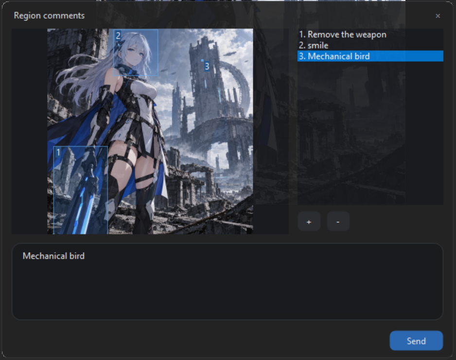
</p>

**Result:** The weapon is gone, the facial expression changes, and a mechanical bird appears above the ruins.

<p align="center">
  
</p>

### 3. BG — work with the background

Choose **BG** for a background operation, such as producing a transparent-background image. This is especially useful for character art, game assets, stickers, and compositing.

<p align="center">
  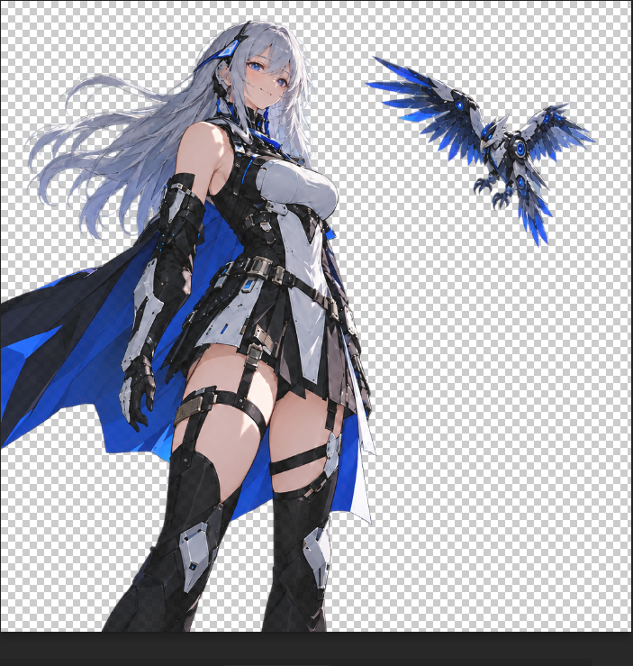
</p>

**Tip:** Zoom in around hair, fabric, and thin shapes to inspect edge quality before exporting the asset.

### 4. Erase — remove an unwanted object

Choose **Erase**, use Photoshop's **freehand lasso** to select the area to remove, and click **Send**. The plugin requests reconstruction of the selected region using its surroundings.

<p align="center">
  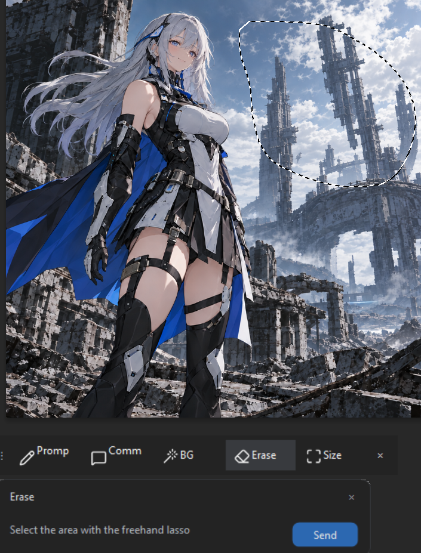
</p>

**Tip:** Select the complete unwanted object plus a small margin for more reliable reconstruction. Keep an original document or layer as a backup before major edits.

### 5. Size — expand or reframe the image

Choose **Size** and select the destination aspect ratio, then click **Generate**. The example menu provides:

| Portrait / square | Landscape |
|:--|:--|
| **1:1** Square | **4:3** Landscape |
| **3:4** Portrait | **16:9** Widescreen |
| **9:16** Story | |

This example expands the original portrait-oriented composition into a widescreen scene rather than stretching the character.

<p align="center">
  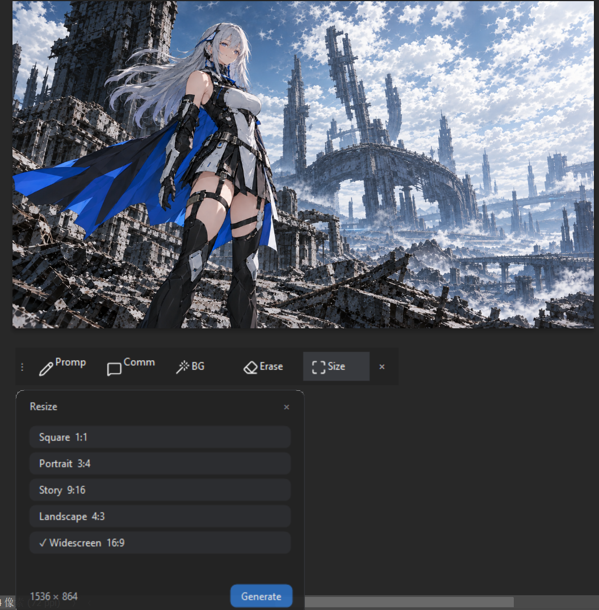
</p>

## Tips for consistent results

- **Be specific.** Mention subject, style, materials, lighting, composition, and what must stay unchanged.
- **Localize edits.** Prefer a small lasso selection or a region comment when editing one detail.
- **Use references.** Attach reference images or **Use PS selection** when you need continuity with existing artwork.
- **Preserve your source.** Save your `.psd` and keep a backup before large edits or aspect-ratio expansion.
- **Check transparency.** Inspect fine hair, soft edges, and translucent materials against contrasting backgrounds.
- **Pick a suitable ratio early.** Large changes in aspect ratio may require generating new surroundings.

## Troubleshooting

If the floating toolbar fails to start, run **`Diagnose.cmd`** from the extracted release folder, then read its output. The desktop executable in this 0.3.5 package is carried over from the 0.3.3 desktop component.


<details>
<summary><strong>Photoshop doesn't show the plugin</strong></summary>

Confirm Adobe Photoshop is version **25.2+**, check that the entire ZIP was extracted, and verify that **UDT loaded `plugin/manifest.json`**. Restart Photoshop if necessary. `Install.cmd` installs the toolbar but does not load the panel.

</details>

<details>
<summary><strong>Test API fails</strong></summary>

Click **Save settings** before **Test API**. Check your provider, endpoint, API key, supported model, and network. **Test API only reads the model list**, so an image request may still fail even after a successful test. Never post raw API keys in diagnostics.

</details>

<details>
<summary><strong>The result is cropped or the framing is wrong</strong></summary>

Match the input composition to the desired output ratio, and review the request summary before generating. Use **Size** when you want additional scene content instead of a simple crop.

</details>

<details>
<summary><strong>A local edit changes too much</strong></summary>

Use a smaller selection or separate region comments. State exactly which elements should remain unchanged and try the edit again from your original document.

</details>

<details>
<summary><strong>Generation is slow or a preview appears to be stuck</strong></summary>

A partial preview is not the completed output. Check the elapsed-time and status messages; if the request fails, review network access, provider rate limits, selected model, and output settings. The **Stop** button cancels an active request.

</details>

## Uninstall

Run **`Uninstall.cmd`** from the extracted release folder to stop the Local desktop toolbar and remove its automatic-start entry. **The uninstaller retains configuration and files.** If you want to remove the Photoshop panel too, unload/remove it from UDT; delete the extracted bundle only after you no longer need it. To clear stored API credentials, click **Clear key** in the plugin settings **before** uninstalling.

## Release verification

The downloaded v0.3.5 ZIP has SHA-256:

```text
cc0d8730fa26ce25bee3bcfb991cd990a335fda7c15a2f48baa3f25729b2dd05
```

The archive passed an integrity check. This **does not** establish malware-free status or end-to-end functional validation on every Photoshop/provider combination. See the release notes for compatibility caveats.

## License and attribution

This repository uses the [Apache License 2.0](LICENSE). Adobe and Photoshop are trademarks of Adobe Inc.; OpenAI and ChatGPT are trademarks of OpenAI. This project is independently developed and is not endorsed by either company.

**Repository:** [springcell/ChatgptImageStudio-Of-Photoshop](https://github.com/springcell/ChatgptImageStudio-Of-Photoshop)  
**Read this guide in Chinese:** [简体中文 README](README.zh-CN.md)
