# ChatGPT Image Studio for Photoshop

[English](README.md) | **简体中文**

[下载 v0.3.7 预览版](https://github.com/springcell/ChatGPT-Image-Studio-for-Photoshop/releases/tag/v0.3.7) · [安装指南](#下载与安装windows) · [绘图 Skill](#绘图-skill-预览) · [反馈问题](https://github.com/springcell/ChatGPT-Image-Studio-for-Photoshop/issues)

**Local 本地版 v0.3.7 · Skill 预览版** · Windows · Adobe Photoshop 25.2+ · UXP

**把 AI 生图、区域修改和可复用的绘图 Skill 带进 Photoshop。**

ChatGPT Image Studio 将 AI 图片生成与 Photoshop 悬浮工具条结合：可以输入提示词生成新图，针对不同区域分别添加修改意见，移除背景或不需要的元素，并将画面扩展至指定比例。

<p align="center">
  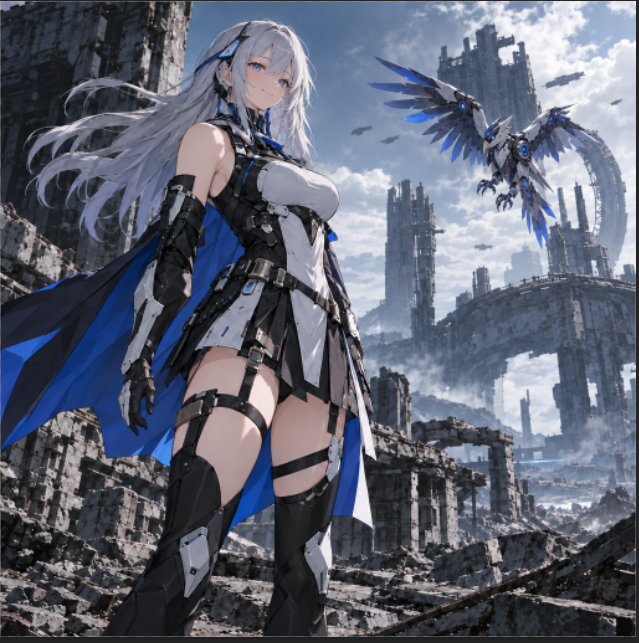
</p>

<p align="center"><strong>Prompt 提示词 · Comment 区域评论 · BG 背景 · Erase 擦除 · Size 尺寸</strong></p>

> [!NOTE]
> 本项目为**独立开发的 Photoshop 插件**，并非 Adobe 或 OpenAI 官方产品。实际可用模型、API 权限和输出行为取决于所选服务商及插件版本。下方截图用于说明操作流程，不代表所有模型与服务商组合均已验证。

## 绘图 Skill 预览

v0.3.7 新增绘图 Skill 管理，用于复用绘图说明和参考资源：

- 从 ZIP、`SKILL.md` 或文件夹导入并管理 Skill。
- 生图时选择 Skill，并决定是否附带其中的资源图片。
- Skill 功能无需独立 Runner 或额外服务；不执行 Skill 内的脚本或扩展步骤。

> [!WARNING]
> **这是预览版，尚未完成生产环境验证。** 根据安装包说明，v0.3.7 已进行离线测试，但尚未完成 **Photoshop 实机验收或真实图片 API 请求验证**。请保留旧版以便回滚。下方截图及详细操作示例来自 v0.3.5，不代表 v0.3.7 已通过端到端验收。

**从这里开始：** [v0.3.7 发布说明与插件下载](https://github.com/springcell/ChatGPT-Image-Studio-for-Photoshop/releases/tag/v0.3.7)。另一个 [v0.3.5-docs 发布包](https://github.com/springcell/ChatGPT-Image-Studio-for-Photoshop/releases/tag/v0.3.5-docs)仅含文档，**不含插件安装器**。

## 下载与安装（Windows）

**运行环境：** Windows、**Adobe Photoshop 25.2 或更高版本**、[Adobe UXP Developer Tool（UDT）](https://developer.adobe.com/photoshop/uxp/2022/guides/devtool/)、可访问所用图片 API 的网络，以及服务商对应的 API Key。

1. 打开 **[v0.3.7 预览版发布页](https://github.com/springcell/ChatGPT-Image-Studio-for-Photoshop/releases/tag/v0.3.7)**，在 **Assets** 中下载 **`chatgpt-image-studio-local-0.3.7-skills.zip`**。不要下载仅含文档的 ZIP，也不要把 GitHub 自动生成的源码压缩包当作安装包。
2. **完整解压 ZIP** 到 Plug-ins目录。不要只单独解压 `Install.cmd`，需保留整个目录结构。
3. 双击根目录的 **`Install.cmd`**，安装并启动**桌面悬浮工具条**。注意：**此步骤不会自动安装 Photoshop 面板。**
4. 打开 **Adobe UXP Developer Tool（UDT）**，点击 **Add Plugin**，选择解压目录中的 **`plugin/manifest.json`**，然后点击 **Load** 加载插件。
5. 在 Photoshop 的 **插件（Plugins）** 菜单中打开 **`chatgpt image studio Local`** 面板（具体位置随 Photoshop 版本变化）。
6. 使用期间保留解压后的插件目录。升级包后，应重新运行 **`Install.cmd`**，并在 UDT 中重新加载对应 `manifest.json`。

发布说明中涉及以下安装入口。请保留**全部**解压文件，不要只保留下方列出的文件：

```text
解压后的安装包目录/
├── Install.cmd              # 安装桌面悬浮工具条
├── SKILLS_README.md         # Skill 用法、限制与回滚说明
└── plugin/
    └── manifest.json        # 在 UDT 中加载此文件
```

> [!IMPORTANT]
> **运行 `Install.cmd` 和通过 UDT 加载 `plugin/manifest.json` 是两个独立步骤，必须分别完成。** 

## 首次配置 API

本节设置和截图说明的是 v0.3.5 操作流程。v0.3.7 的 Skill 用法、限制和回滚步骤请阅读安装包内的 `SKILLS_README.md`。远程生图仍需自行配置服务商 API；Skill 功能不提供 API 账号或调用额度。

1. 在 Photoshop 中打开插件面板，点击右上角的**设置图标**。
2. 选择 **Language / 语言**（English 或 中文）与 **Provider / 服务商**（例如 OpenAI 或兼容网关 sub2api）。
3. 使用 OpenAI 官方接口时，**API base URL / 接口地址**可以留空，默认采用 `https://api.openai.com/v1`；使用其他服务商时填写其提供的地址。
4. 在 **API Key** 中输入密钥。根据安装包说明，API 配置保存在 Photoshop 本机的 **UXP secureStorage** 中，不会把 API Key 传给桌面工具条。
5. 选择 **Image model / 图像模型**。v0.3.5 提供 **Flare 2.5、Sunburst 2.5、Flare 2.6、Sunburst 2.6** 四个服务商模型选项；具体能否调用取决于服务商。
6. 点击 **Save settings / 保存设置**，再点击 **Test API / 测试 API**。测试只请求**模型列表**，不发起图片生成请求，也**不能证明**当前账号拥有该模型的生图权限。
7. 根据需要启用 **Remember edits / 记住编辑记录**，并使用 **Show toolbar / Hide toolbar** 显示或隐藏桌面工具条。

<p align="center">
  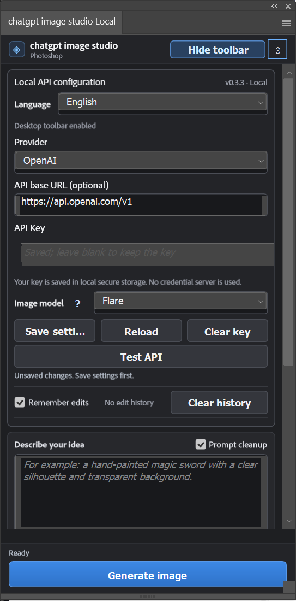
</p>

> [!NOTE]
> **v0.3.5 兼容性说明（依据安装包自带说明）：** Sunburst 2.6 完成过一次**直连、非流式**生图测试；Flare 2.6 **尚未验证**。2.6 的流式预览、图片编辑、Photoshop 实机联动和 sub2api 兼容性仍待测试。这里的模型名称是服务商侧选项，不代表它们均为 OpenAI 官方公开模型 ID。
>
> 更换 Provider 或接口地址时需重新输入 API Key。公网接口请使用 HTTPS；本机或私有局域网使用 HTTP 时传输不加密。

## 生成第一张图片

1. 在 **Describe your idea / 描述你的创意** 中输入图片需求，例如：

   > Generate a sci-fi anime-style female warrior standing before ruins.

2. 可选开启 **Prompt cleanup / 提示词清理**；也可以添加 **References / 参考图**（截图界面显示最多 16 张），或点击 **Use PS selection / 使用 PS 选区**，将 Photoshop 当前选区作为参考。
3. 设置 **Width / 宽度**、**Height / 高度**及 **Quality / 质量**；背景模式可选择 `Auto / 自动`、`Transparent / 透明` 或 `Opaque / 不透明`。
4. 点击 **Generate image / 生成图片**。
5. 生成过程中可能出现 **Partial preview / 局部预览**；它不等于最终结果。示例流程中，完成的图片会在 **Photoshop 新文档**中打开。

<p align="center">
  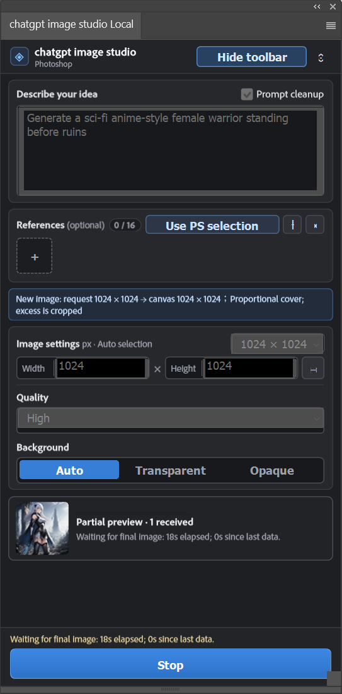
</p>

**首次生成效果：**

<p align="center">
  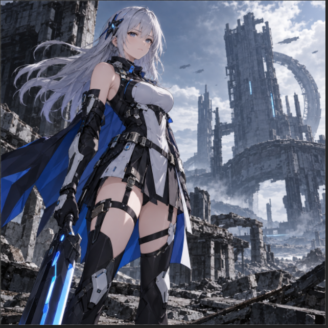
</p>

**提示：** 生图前尽量确定目标画面比例。如果生成构图与输出画布比例不同，插件可能进行裁切或等比覆盖；请留意面板中的请求摘要。

## 悬浮工具条速览

在 Photoshop 中打开图片并启用桌面工具条后，可以使用以下五个主要功能：

<p align="center">
  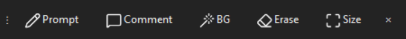
</p>

| 按钮 | 功能 | 适用场景 |
|:--|:--|:--|
| 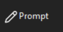 | **提示词修改**：用文字描述想生成或修改的内容。 | 改场景、改风格、添加元素 |
| 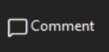 | **区域评论**：给图片不同区域分别添加修改指令。 | 一次修改多个局部 |
| 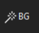 | **背景处理**：制作透明背景等效果。 | 抠图、游戏素材、角色合成 |
| 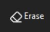 | **擦除重建**：在选区中移除不需要的内容。 | 删除杂物、修复背景 |
| 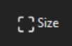 | **画面尺寸**：调整比例，生成扩展后的构图。 | 横版、竖版、故事封面 |

### 1. Prompt — 提示词修改

点击工具条上的 **Prompt**，输入想要生成或调整的内容，再点击 **Send / 发送**。可以直接描述人物、环境、色彩、动作或希望保留的部分。

<p align="center">
  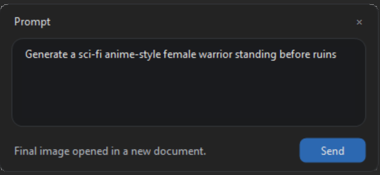
</p>

### 2. Comment — 区域评论与局部编辑

点击 **Comment** 打开 **Region comments / 区域评论**。在图像上圈选不同位置，为每一个区域填写独立指令，再点击 **Send** 提交。

下面这张示例图包含三条评论：

1. **Remove the weapon** — 删除手中的武器；
2. **Smile** — 让角色微笑；
3. **Mechanical bird** — 在天空中加入机械鸟。

<p align="center">
  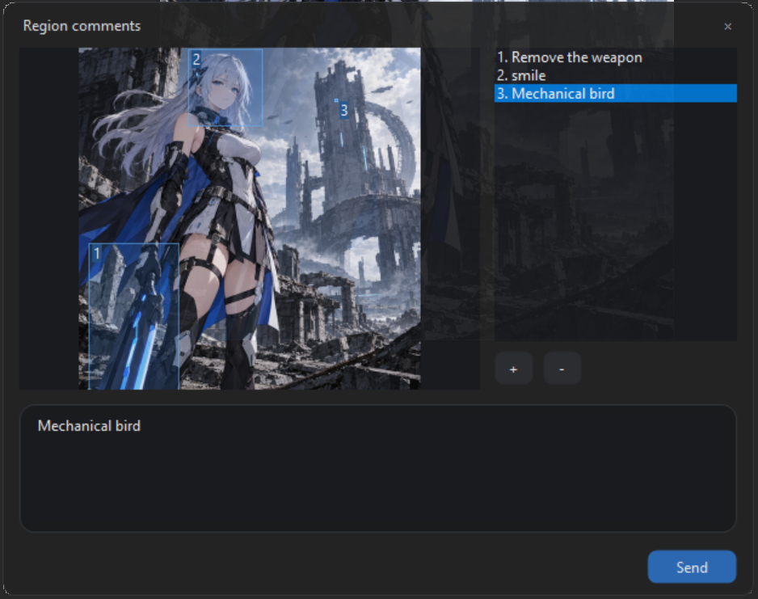
</p>

**修改后的效果：** 武器被移除，人物表情发生变化，空中增加了一只机械鸟。

<p align="center">
  
</p>

### 3. BG — 背景处理与透明化

点击 **BG** 进行背景操作。示例中保留人物和机械鸟，并将原本的城市废墟背景处理为**透明背景**，适合制作角色立绘、贴纸及游戏资源。

<p align="center">
  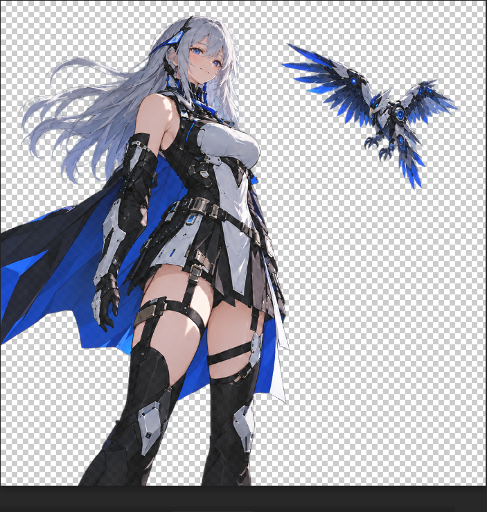
</p>

**提示：** 使用透明图时，应放大查看头发、披风边缘以及其他细小结构，检查是否存在残留或边缘缺陷。

### 4. Erase — 选区擦除

点击 **Erase**，用 Photoshop 的**自由套索工具**圈选需要删除的区域，然后点击 **Send**。插件会根据周围画面尝试补全选区中的内容。

<p align="center">
  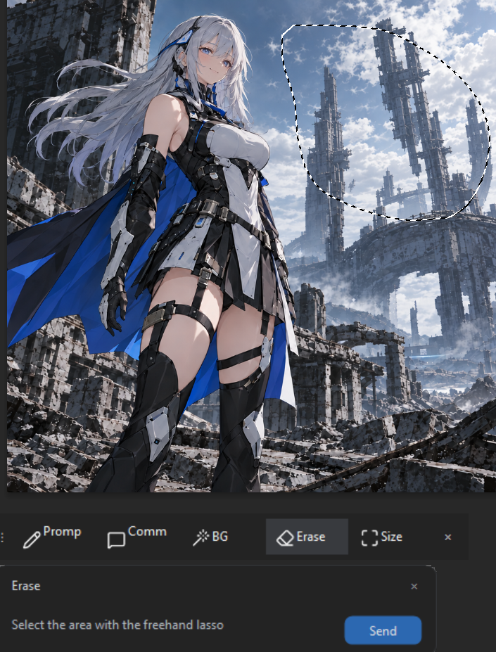
</p>

**提示：** 选区最好包含完整目标和少量周边范围。进行较大范围修改前，先保留原始图层或 PSD 备份。

### 5. Size — 调整比例并扩展画面

点击 **Size**，选中所需的画面比例，再点击 **Generate / 生成**。截图中的预设包括：

| 竖版 / 方形 | 横版 |
|:--|:--|
| **1:1** Square（方形） | **4:3** Landscape（横版） |
| **3:4** Portrait（竖版） | **16:9** Widescreen（宽屏） |
| **9:16** Story（故事竖屏） | |

示例将原本接近竖版的构图扩展为 **16:9 宽屏画面**：补充两侧场景，而不是把人物简单拉宽。

<p align="center">
  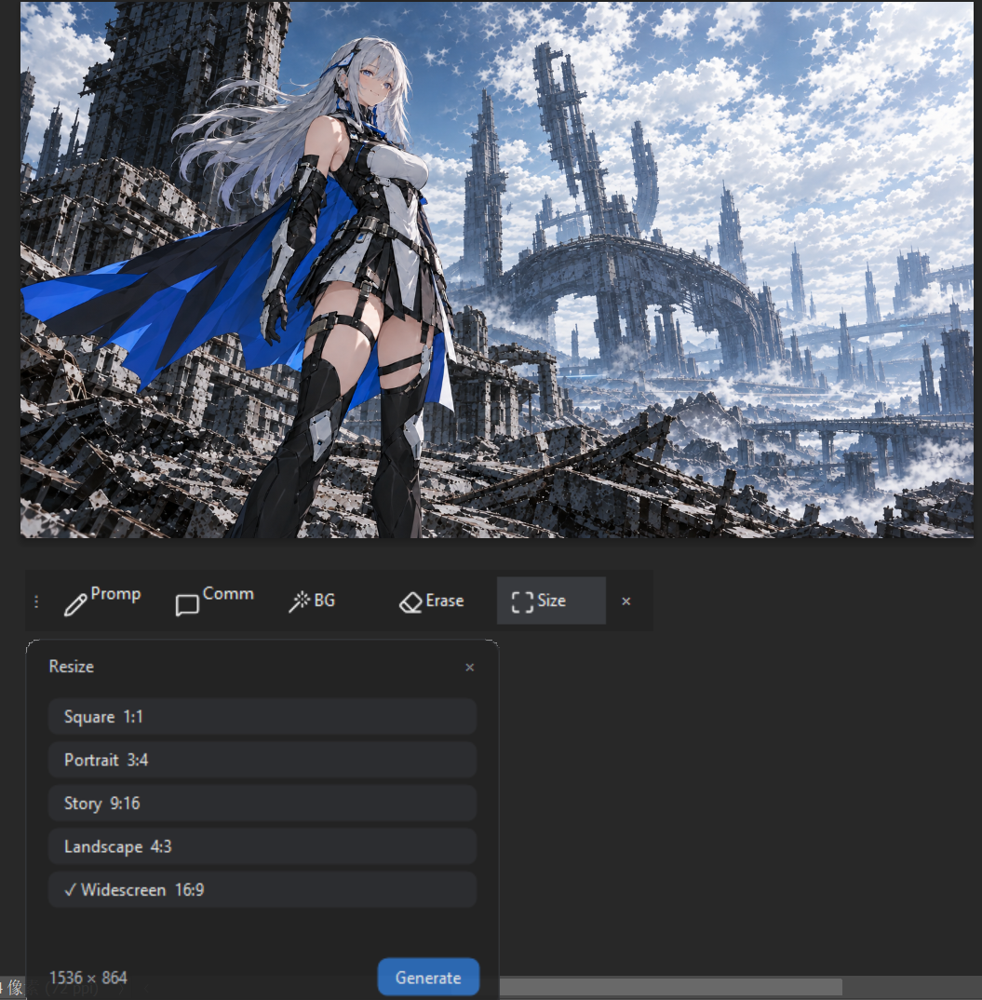
</p>

## 使用技巧

- **描述要具体：** 说明主体、绘画风格、材质、灯光、构图，以及哪些内容必须保持不变。
- **局部修改尽量精确：** 修改一个对象时，优先使用小范围选区或单独的 Comment 评论。
- **参考图帮助保持一致性：** 可添加 References，或者使用 **Use PS selection** 参考现有画面。
- **保留源文件：** 大面积重绘或修改比例前保存 PSD，并备份原始图层。
- **检查透明边缘：** 对毛发、半透明材料和布料边缘进行放大检查。
- **提前确定比例：** 大幅改变宽高比时可能需要生成新增的场景内容。

## 常见问题

### 插件面板没有出现

确认 Photoshop 版本不低于 **25.2**、ZIP 已完整解压，并且已经在 **UDT 加载 `plugin/manifest.json`**。必要时重启 Photoshop。`Install.cmd` 只安装悬浮工具条，**不会自动加载面板**。

### 悬浮工具条没有启动

在解压目录运行 **`Diagnose.cmd`** 查看桌面工具条状态。根据诊断提示处理后，可以重新运行 `Install.cmd`。0.3.5 内的桌面 EXE 沿用 0.3.3 组件。

### Test API 失败

先点击 **Save settings**，再执行 **Test API**。检查服务商、地址、API Key、模型授权及网络。注意测试只读取模型列表，成功也不表示能够生图。分享诊断信息时**不要包含 API Key**。

### 图片被裁剪或构图不正确

尽量让输入构图与输出画布宽高比一致；生成前查看请求摘要。如果想增加画面内容，而不是仅裁剪图片，可以使用 **Size** 工具。

### 局部修改影响了其他区域

缩小选区或分开添加 Comment 评论，并明确写出哪些对象与细节需要保持不变；必要时从未修改的原始文档重试。

### 只有预览图，最终结果迟迟没有出现

**Partial preview 不是最终完成的图片**。查看运行状态与耗时信息，检查服务商限流、网络、模型可用性和尺寸设置；可以使用 **Stop** 取消当前请求。

## 卸载

运行安装包中的 **`Uninstall.cmd`**，停止本地桌面工具条并移除自动启动项。**此操作会保留本地配置和文件。** 如需移除 Photoshop 插件面板，请在 UDT 中卸载 / 移除插件。若要删除已保存的 API 凭据，应先在插件设置中点击 **Clear key / 清除密钥**，再进行卸载。

## 安装包校验

文件名：`chatgpt-image-studio-local-0.3.7-skills.zip`

v0.3.7 发布附件记录的 SHA-256：

```text
8d1d5910c956d43e60eea3a3cdd77dffa974bfd8aedb6917c9d7f10b5abd9a0a
```

安装前可将下载文件的 SHA-256 与以上数值核对。校验值一致只说明文件一致，**不代表已完成恶意软件安全审计或 Photoshop / API 端到端验证**。

## 试用与反馈

[下载预览版](https://github.com/springcell/ChatGPT-Image-Studio-for-Photoshop/releases/tag/v0.3.7)，先用作品副本试用。如遇可复现问题，请在 [Issues](https://github.com/springcell/ChatGPT-Image-Studio-for-Photoshop/issues) 中提供 Windows / Photoshop 版本、插件版本、服务商与模型名称、操作步骤、预期结果和实际结果。**不要提交 API Key 或私人作品。**

工作流建议或有权公开的使用案例可以发到 [Discussions](https://github.com/springcell/ChatGPT-Image-Studio-for-Photoshop/discussions)。如果这个项目对你有帮助，欢迎点一个 Star，让更多人发现它。

## 许可与声明

仓库遵循 [Apache License 2.0](LICENSE)。Adobe、Photoshop 是 Adobe Inc. 的商标；OpenAI、ChatGPT 是 OpenAI 的商标。本项目为独立开发，不代表获得上述公司的官方认可或背书。

**项目仓库：** [springcell/ChatGPT-Image-Studio-for-Photoshop](https://github.com/springcell/ChatGPT-Image-Studio-for-Photoshop)  
**English documentation:** [README.md](README.md)
